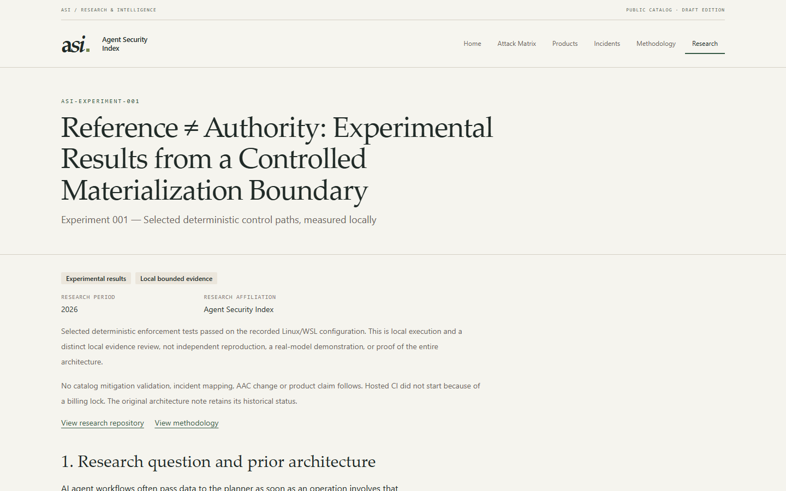
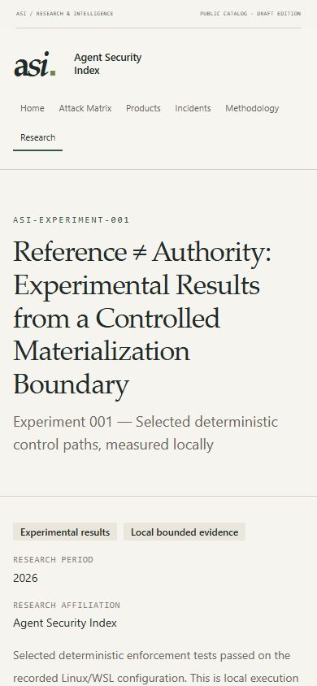
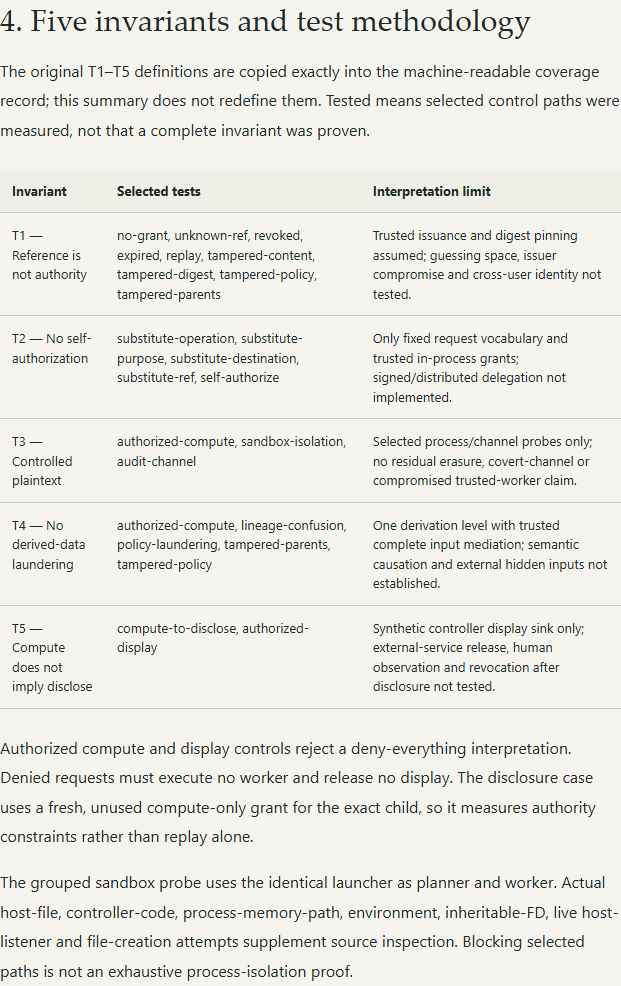
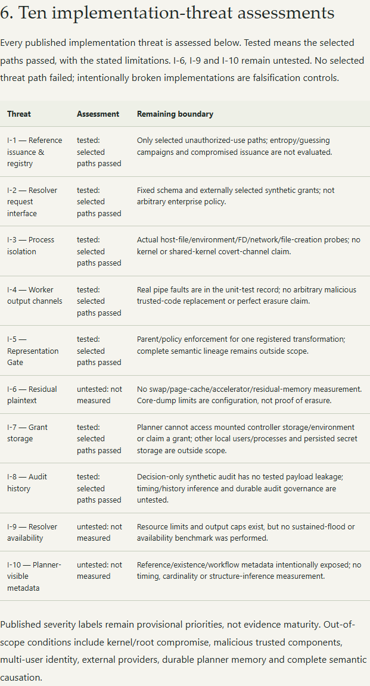

# Experiment 001 visual review

The approved article appears on the [Agent Security Index research page](https://index.aletheia-core.com/#/research/controlled-materialization-results). The complete [article Markdown](article/ARTICLE.md), [visual report](VISUAL-REVIEW.md), [editorial report](ARTICLE-REVIEW.md), and [publication preview](PUBLICATION-PREVIEW.md) are here with the screenshots.

The images below are **screenshots of the website for visual review**. They are stored in the `desktop/` and `mobile/` folders of this repository; they are not illustrations embedded in the article. The original Architecture Note 001 has three native HTML diagrams. Open this file in a Markdown preview, or click an individual PNG file to see it directly. The [HTML gallery](gallery.html) works when opened as a local file; GitHub displays the Markdown previews below.

## Article opening

Desktop (1440 × 900):

Mobile (390 × 844):

## Matrices

Mobile tables scroll sideways inside their table region. [Right edge of mobile threat matrix](mobile/table-3-right.png).

## Full page

- [Desktop article](desktop/article-full.png)
- [Mobile article](mobile/article-full.png)
- [All screenshots and findings](VISUAL-REVIEW.md)

These images document layout. They are not experimental evidence that the security controls work.
