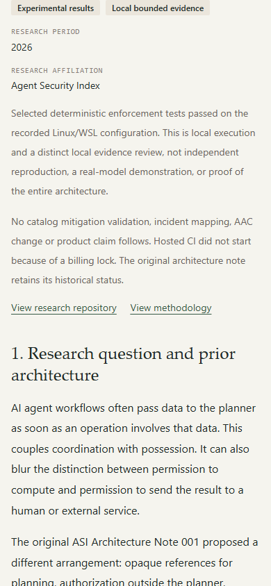
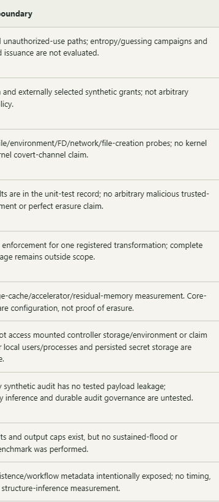
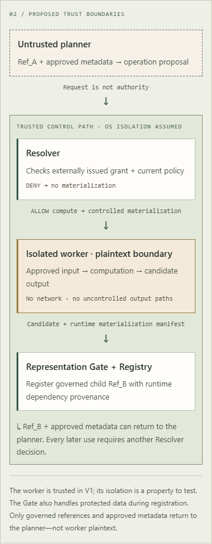

# Visual review

[HTML gallery](gallery.html) · [Contact sheet](review/contact-sheet.png) · [Inspection data](review/inspection.json)

Captured 2026-10-12T20:43:33.544Z from the actual local production build. Desktop: **1440 × 900**. Mobile: **390 × 844**, mobile/touch emulation, device scale 1. Chromium waited for network idle and document fonts. Section captures include full element heights; full-page images preserve all ten sections. Screenshots are UI evidence only, not proof of experimental security effectiveness.

## Findings and correction

**PASS after one minimal correction.** The original 680px table minimum exceeded the desktop article column (621px), requiring sideways scrolling and hiding the right edge at initial position. A three-line CSS media rule now removes the minimum at viewport widths of 768px and above. All three desktop tables now have client width and scroll width of 621px. Article wording and research evidence were unchanged.

Mobile tables retain a 680px table inside a 358px scroll region. Each is focusable and ArrowRight moved it by 40px. Supplemental right-edge screenshots show remaining columns. A single mobile screenshot cannot expose all columns simultaneously. Neither viewport has horizontal page overflow.

Inspected the gallery/contact sheet and detailed opening, status, invariant/threat tables, listing cards and architecture diagrams. No additional blocking visual defect was found. Typography and section spacing remain consistent, diagram labels are readable, and the listing distinguishes the original story, historical architecture proposal and bounded experimental results. All ten sections and three tables render. No missing images or browser page errors were recorded on the five routes at either size.

## Navigation and links

The article was opened from the research listing at both sizes. Direct refresh and Back to research pass. A capture-script timing race was fixed by waiting for the destination heading; no application navigation change was necessary.

- HTTP 200: https://github.com/holeyfield33-art/Asi-Research-v2/tree/4ac3224a5237937305596abe0d70d67290bc3575
- HTTP 200: https://github.com/holeyfield33-art/Asi-Research-v2/blob/bb5b48bc535b23430ab439e584e2caebf1fb5115/docs/PROTOCOL.md
- HTTP 200: https://github.com/containers/bubblewrap#sandbox-security
- HTTP 200: https://github.com/holeyfield33-art/Asi-Research-v2/tree/bb5b48bc535b23430ab439e584e2caebf1fb5115
- HTTP 200: https://github.com/holeyfield33-art/Asi-Research-v2/blob/f5e603ee8f10953c8ca38601f7467eb77bf4cb06/results/experiment-001.json
- HTTP 200: https://github.com/holeyfield33-art/Asi-Research-v2/blob/f5e603ee8f10953c8ca38601f7467eb77bf4cb06/results/verification.json
- HTTP 200: https://index.aletheia-core.com/#/research/reference-not-authority

## Inventory

54 screenshots plus one contact sheet. Opening, status and section 1 jointly show title, subtitle, evidence labels and introduction. Sections 2–10 cover architecture, setup, T1–T5, results/failures, I-1–I-10, limitations, interpretation, reproduction and conclusion. Element and full-page image dimensions vary with content; the browser viewports remain the required sizes.

### desktop

- [home](desktop/home.png) — http://127.0.0.1:4179/#/
- [home-full](desktop/home-full.png) — http://127.0.0.1:4179/#/
- [research-listing](desktop/research-listing.png) — http://127.0.0.1:4179/#/research
- [research-listing-full](desktop/research-listing-full.png) — http://127.0.0.1:4179/#/research
- [architecture-note](desktop/architecture-note.png) — http://127.0.0.1:4179/#/research/reference-not-authority
- [architecture-note-full](desktop/architecture-note-full.png) — http://127.0.0.1:4179/#/research/reference-not-authority
- [architecture-diagram-1](desktop/architecture-diagram-1.png) — http://127.0.0.1:4179/#/research/reference-not-authority
- [architecture-diagram-2](desktop/architecture-diagram-2.png) — http://127.0.0.1:4179/#/research/reference-not-authority
- [architecture-diagram-3](desktop/architecture-diagram-3.png) — http://127.0.0.1:4179/#/research/reference-not-authority
- [research-001](desktop/research-001.png) — http://127.0.0.1:4179/#/research/asi-research-001
- [research-001-full](desktop/research-001-full.png) — http://127.0.0.1:4179/#/research/asi-research-001
- [article-opening](desktop/article-opening.png) — http://127.0.0.1:4179/#/research/controlled-materialization-results
- [article-status](desktop/article-status.png) — http://127.0.0.1:4179/#/research/controlled-materialization-results
- [article-section-01](desktop/article-section-01.png) — http://127.0.0.1:4179/#/research/controlled-materialization-results
- [article-section-02](desktop/article-section-02.png) — http://127.0.0.1:4179/#/research/controlled-materialization-results
- [article-section-03](desktop/article-section-03.png) — http://127.0.0.1:4179/#/research/controlled-materialization-results
- [article-section-04](desktop/article-section-04.png) — http://127.0.0.1:4179/#/research/controlled-materialization-results
- [article-section-05](desktop/article-section-05.png) — http://127.0.0.1:4179/#/research/controlled-materialization-results
- [article-section-06](desktop/article-section-06.png) — http://127.0.0.1:4179/#/research/controlled-materialization-results
- [article-section-07](desktop/article-section-07.png) — http://127.0.0.1:4179/#/research/controlled-materialization-results
- [article-section-08](desktop/article-section-08.png) — http://127.0.0.1:4179/#/research/controlled-materialization-results
- [article-section-09](desktop/article-section-09.png) — http://127.0.0.1:4179/#/research/controlled-materialization-results
- [article-section-10](desktop/article-section-10.png) — http://127.0.0.1:4179/#/research/controlled-materialization-results
- [table-1-right](desktop/table-1-right.png) — http://127.0.0.1:4179/#/research/controlled-materialization-results
- [table-2-right](desktop/table-2-right.png) — http://127.0.0.1:4179/#/research/controlled-materialization-results
- [table-3-right](desktop/table-3-right.png) — http://127.0.0.1:4179/#/research/controlled-materialization-results
- [article-full](desktop/article-full.png) — http://127.0.0.1:4179/#/research/controlled-materialization-results

### mobile

- [home](mobile/home.png) — http://127.0.0.1:4179/#/
- [home-full](mobile/home-full.png) — http://127.0.0.1:4179/#/
- [research-listing](mobile/research-listing.png) — http://127.0.0.1:4179/#/research
- [research-listing-full](mobile/research-listing-full.png) — http://127.0.0.1:4179/#/research
- [architecture-note](mobile/architecture-note.png) — http://127.0.0.1:4179/#/research/reference-not-authority
- [architecture-note-full](mobile/architecture-note-full.png) — http://127.0.0.1:4179/#/research/reference-not-authority
- [architecture-diagram-1](mobile/architecture-diagram-1.png) — http://127.0.0.1:4179/#/research/reference-not-authority
- [architecture-diagram-2](mobile/architecture-diagram-2.png) — http://127.0.0.1:4179/#/research/reference-not-authority
- [architecture-diagram-3](mobile/architecture-diagram-3.png) — http://127.0.0.1:4179/#/research/reference-not-authority
- [research-001](mobile/research-001.png) — http://127.0.0.1:4179/#/research/asi-research-001
- [research-001-full](mobile/research-001-full.png) — http://127.0.0.1:4179/#/research/asi-research-001
- [article-opening](mobile/article-opening.png) — http://127.0.0.1:4179/#/research/controlled-materialization-results
- [article-status](mobile/article-status.png) — http://127.0.0.1:4179/#/research/controlled-materialization-results
- [article-section-01](mobile/article-section-01.png) — http://127.0.0.1:4179/#/research/controlled-materialization-results
- [article-section-02](mobile/article-section-02.png) — http://127.0.0.1:4179/#/research/controlled-materialization-results
- [article-section-03](mobile/article-section-03.png) — http://127.0.0.1:4179/#/research/controlled-materialization-results
- [article-section-04](mobile/article-section-04.png) — http://127.0.0.1:4179/#/research/controlled-materialization-results
- [article-section-05](mobile/article-section-05.png) — http://127.0.0.1:4179/#/research/controlled-materialization-results
- [article-section-06](mobile/article-section-06.png) — http://127.0.0.1:4179/#/research/controlled-materialization-results
- [article-section-07](mobile/article-section-07.png) — http://127.0.0.1:4179/#/research/controlled-materialization-results
- [article-section-08](mobile/article-section-08.png) — http://127.0.0.1:4179/#/research/controlled-materialization-results
- [article-section-09](mobile/article-section-09.png) — http://127.0.0.1:4179/#/research/controlled-materialization-results
- [article-section-10](mobile/article-section-10.png) — http://127.0.0.1:4179/#/research/controlled-materialization-results
- [table-1-right](mobile/table-1-right.png) — http://127.0.0.1:4179/#/research/controlled-materialization-results
- [table-2-right](mobile/table-2-right.png) — http://127.0.0.1:4179/#/research/controlled-materialization-results
- [table-3-right](mobile/table-3-right.png) — http://127.0.0.1:4179/#/research/controlled-materialization-results
- [article-full](mobile/article-full.png) — http://127.0.0.1:4179/#/research/controlled-materialization-results

## Embedded previews

